<p align="center"></p>

<h1 align="center">Warden</h1>

<p align="center">
A self-hosted licence manager that runs on Cloudflare Workers, D1 and R2.<br>
License a product to many customers or a single project, give every licence a key and a check URL,<br>
and control its status, its sites and its downloads from a dashboard or an API.
</p>

<p align="center">
<a href="https://deploy.workers.cloudflare.com/?url=https://github.com/momardia54/Warden"></a>
</p>

> **Status: pre-1.0 (latest release 0.4.0; 0.5.0 in development).** It works and is tested, but the API and data model may still change before 1.0.0; every change is listed in [CHANGELOG.md](CHANGELOG.md). Versioning and the plan to 1.0.0: [Roadmap.md](Roadmap.md). Security model: [Security.md](Security.md).

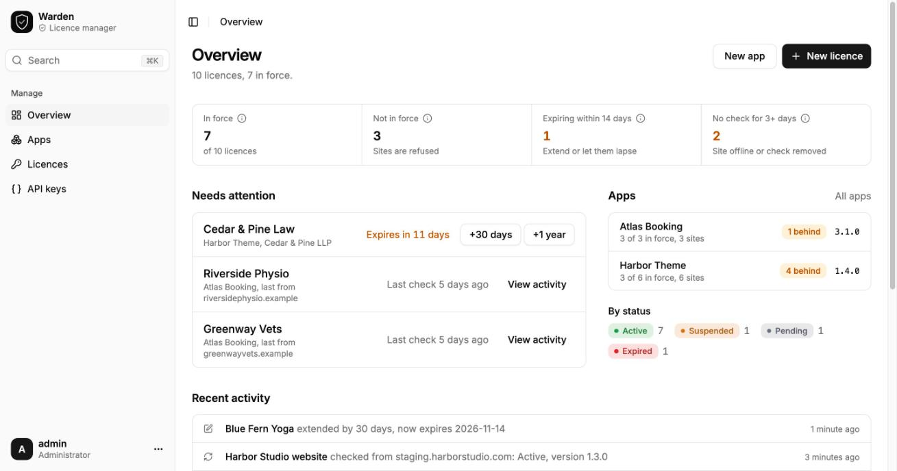

## Quick start

1. **Deploy:** click **Deploy to Cloudflare** above. It creates the Worker, a D1 database named `<worker-name>-db`, an R2 bucket for files named `<worker-name>-files` and a Cron Trigger (every 10 minutes). If you install more than one copy in an account, give each Worker a different name. R2 has to be activated once in your Cloudflare account (it asks for a payment method, even for the free tier); without it everything works except the Files sections.
2. **Sign in:** open your Worker's address. Until you add the admin login as runtime secrets, the login page shows what is missing and how to add it.

   | Name | Type | Required |
   |---|---|---|
   | `ADMIN_USERNAME` | secret | yes |
   | `ADMIN_PASSWORD` | secret (12+ characters) | yes |
   | `SESSION_SECRET` | secret | recommended |
   | `DB_SUFFIX` | *build* variable | optional (custom database name) |

3. **Issue a licence:** create an app (or skip it for a standalone licence), then a licence. Put the check URL in the customer's site. [docs/checking.md](docs/checking.md) has the code to do it.

## How it works

1. You issue a licence in Warden, from the dashboard or the API, for a standalone project or under an app. Warden gives it a **licence key** and a **check URL**.
2. The customer's site calls the check URL with its domain and its installed version (for example every 12 hours) and reads the response: `valid`, `status`, `message`, and whether an update is waiting.
3. You change the licence status, or publish a new release, in the dashboard or by API. The next time the site checks, it sees the change and acts on it.

Warden **creates and manages** licences. **Enforcement lives in the site's code**, so you decide what an invalid licence does: show a notice, switch a feature off, show a maintenance page. [docs/checking.md](docs/checking.md) has PHP and JavaScript examples, including how to verify the signed response.

## Features

- **Release tracks**: what each licence status receives, for example Updates for Active licences, the licence-free Final build for Completed ones and a maintenance version for Suspended ones. Each status belongs to one track, so a site is always offered the latest release of exactly one track; a licence can have its own track for a custom build ([docs/releases.md](docs/releases.md#tracks))
- **Releases and updates**: upload a build with a version and every site that sends its version with its check is told an update is waiting, with the release notes, a SHA-256 checksum and a ready download link. Stable and beta channels, withdraw a bad release in one click, and see which version each site runs and how many are behind ([docs/releases.md](docs/releases.md))
- **Publishing from GitHub**: connect GitHub once (Warden creates its own GitHub App in two clicks), pick a repository for a release track, and every version tag you push is downloaded as a zip, repacked with a fixed folder name and published as a release. Private repositories included, no token or webhook to copy; a token-and-webhook mode remains for single repositories ([docs/repositories.md](docs/repositories.md))
- **Apps**: a product sold to many customers, with defaults for new licences (status, duration, maximum sites, message), its own licence list and releases shared by all of its licences ([docs/apps.md](docs/apps.md))
- **Site limit**: a licence can be limited to N sites; sites register on their first check and you can release them
- **Grace period**: an app, or a licence, can keep licences valid for some days after their expiry date, with a reminder in the check response, so a late renewal does not interrupt a site ([docs/statuses.md](docs/statuses.md#grace-period))
- **Webhooks**: Warden calls your URLs when a licence is created, renewed, changes status, enters its grace period, expires, goes without a check for 3 days, or is deleted. Signed with the installation's key, retried for about a day, with a delivery log and a test button ([docs/webhooks.md](docs/webhooks.md))
- Licence key (`WRD-XXXXX-XXXXX-XXXXX-XXXXX`) and a ready-to-use check URL per licence, with a customer name and email
- **Configurable statuses** at app level and licence level: everything starts with a built-in set (pending, active, completed, suspended, disabled, expired). An app can customise its own, shared by all of its licences, and a standalone licence can customise its own. Each status says whether it is valid, what it becomes when the expiry date passes, its colour (any colour, with presets) and its message to sites ([docs/statuses.md](docs/statuses.md))
- Optional expiry date, optional allowed domains (subdomains match), a public message returned to the site, internal notes
- **Signed responses and releases**: every check and download answer is signed with the installation's Ed25519 key, and every release carries a signature of its checksum; sites verify with the public key alone ([docs/checking.md](docs/checking.md))
- Activity log per licence: every check (which domain, which result) and every change
- **Protection**: client IP address of every check and download, an IP blocklist (addresses and CIDR ranges), rate limits per IP address, licence key and API key, and blocking rules (invalid licence keys, invalid checks, licences per IP address, rate limit violations) with an allowlist, all configured in the dashboard ([docs/protection.md](docs/protection.md))
- **Analytics**: valid and invalid checks per day, invalid checks by reason, active sites, downloads, and top licences, files and IP addresses, over 7, 30 or 90 days, for everything or one app ([docs/analytics.md](docs/analytics.md))
- **Overview** with a *Needs attention* queue: licences expiring soon (extend them in one click) and valid licences with no recent check, plus apps with outdated sites
- **Quick search** (Ctrl+K or Cmd+K) across licences, customers, keys, site domains and apps
- **Licence list** with saved views in the address (valid, invalid, expiring, no recent check), filters, sorting and **CSV export**
- **Files per licence** (stored in R2), each with a release rule: the licence statuses in which it can be downloaded. Use it to ship updates while a licence is valid, to release a final build when the client has paid in full, or to serve a notice while a licence is suspended ([docs/files.md](docs/files.md))
- **Extend expiry** in one click (+30 days, +90 days, +1 year) and **regenerate key**
- **API** with scoped keys, idempotent create, renew, status, search and paging, plus an OpenAPI description
- Single admin login from Worker secrets, no third-party services, runs on the Workers and D1 free plans

| | |
|---|---|
| 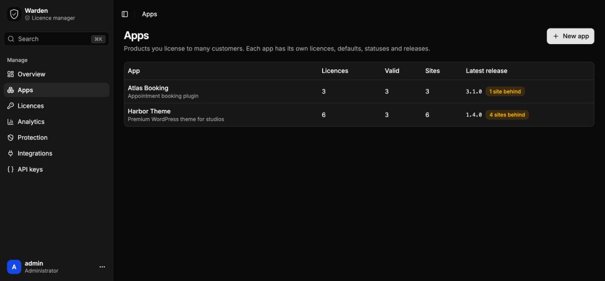 | 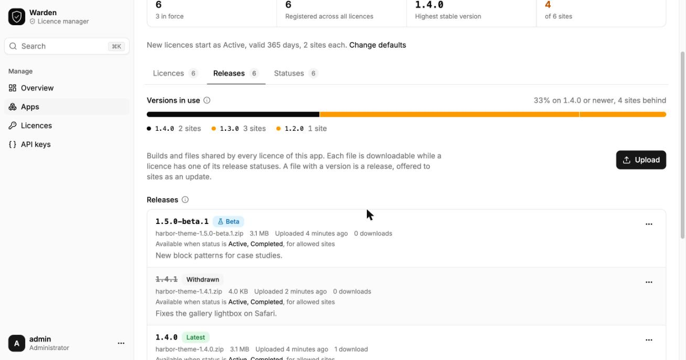 |
| Apps with licence counts, valid licences, sites and outdated sites | An app: licences, sites, latest release and checks of the last 30 days |
| 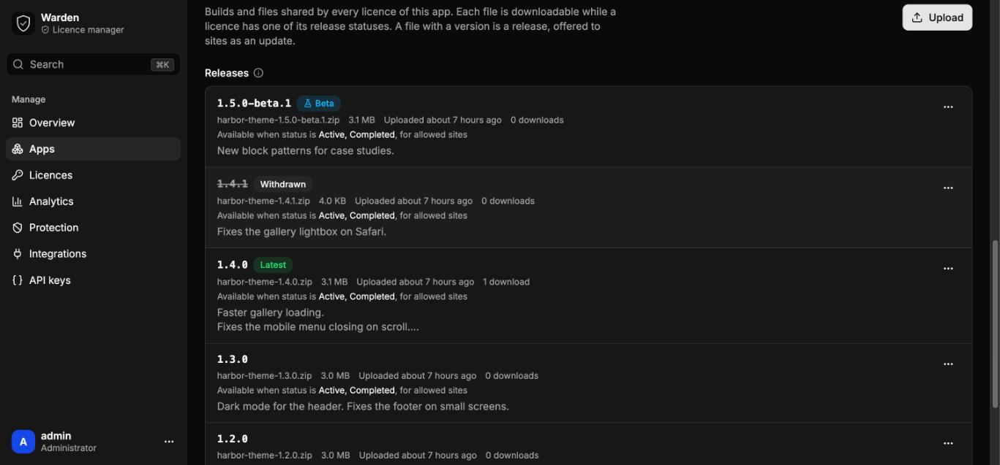 | 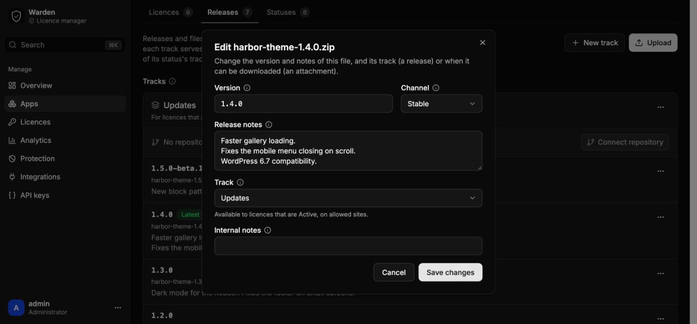 |
| Release tracks of an app, each serving a set of licence statuses | Editing a release: version, channel, release notes and track |
| 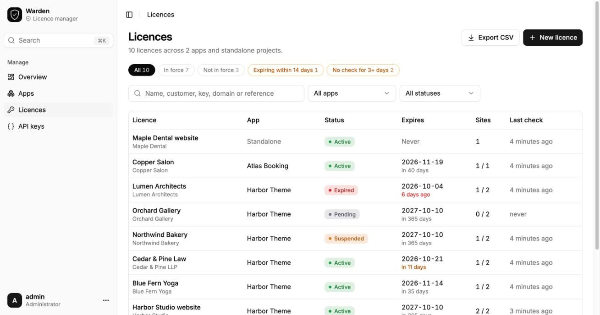 | 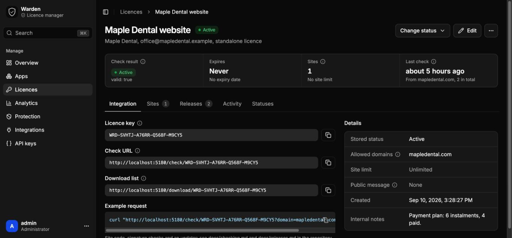 |
| Licences of all apps, with views, filters and sorting | A licence: check result, expiry, sites and last check |
| 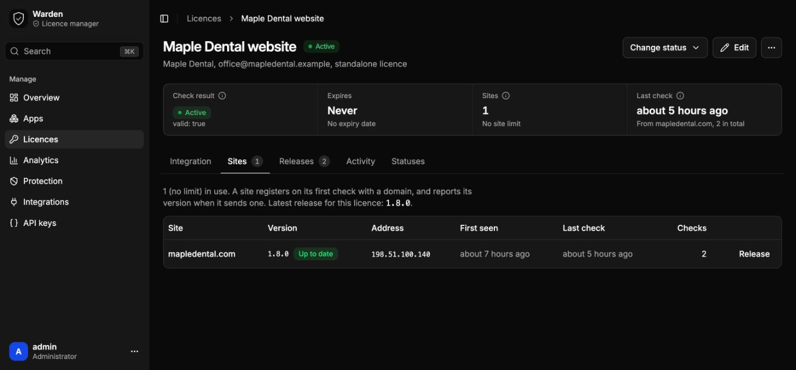 | 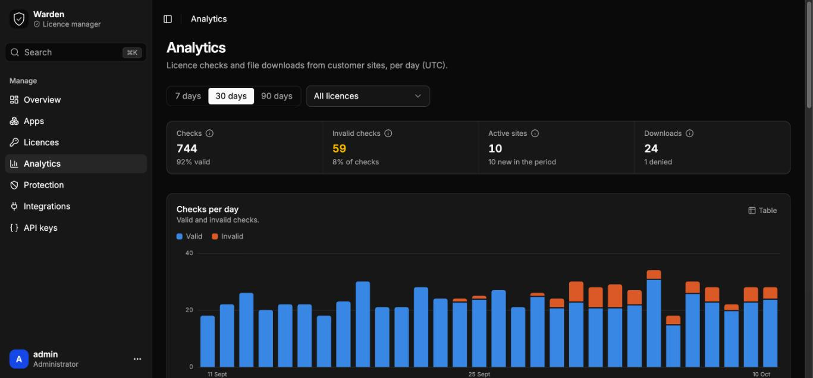 |
| Registered sites, the version each one runs and its address | Analytics: valid and invalid checks per day |
| 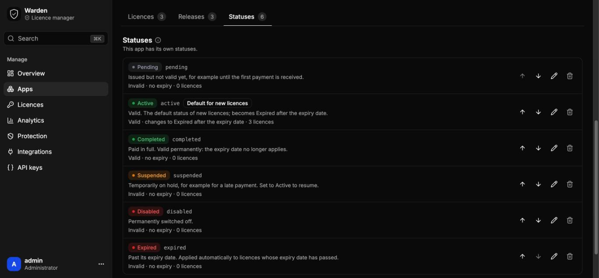 | 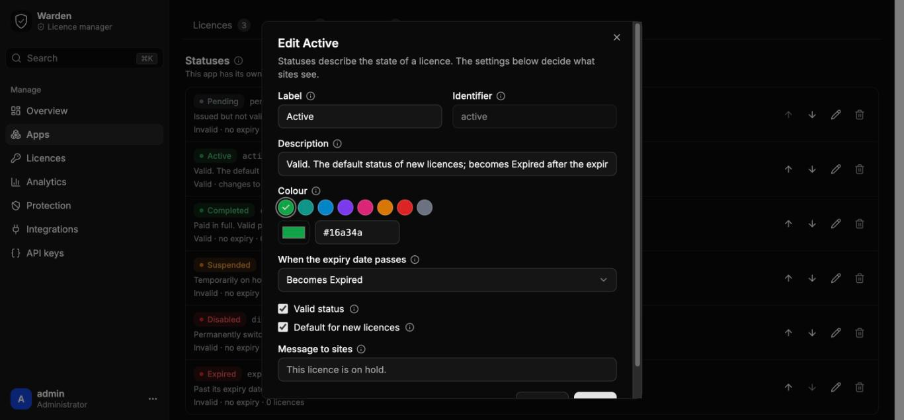 |
| An app with its own statuses | Editing a status: colour, expiry rule, valid status and message |
| 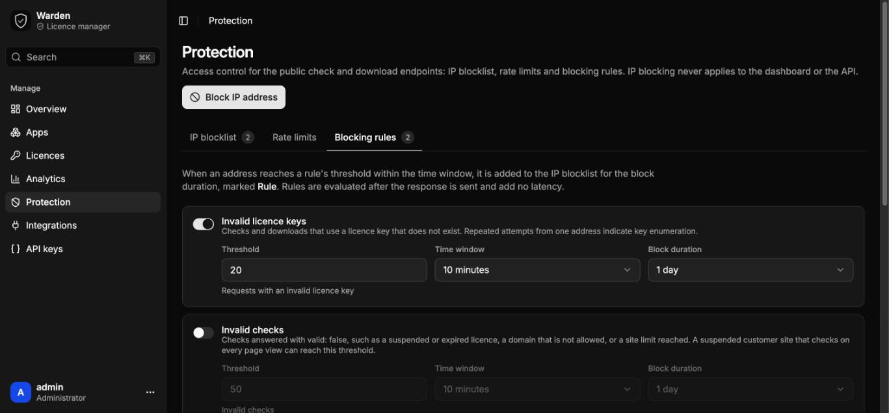 | 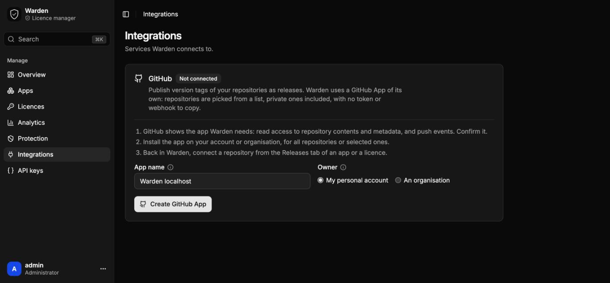 |
| Protection: blocking rules with threshold, time window and block duration | Integrations: connecting GitHub |
| 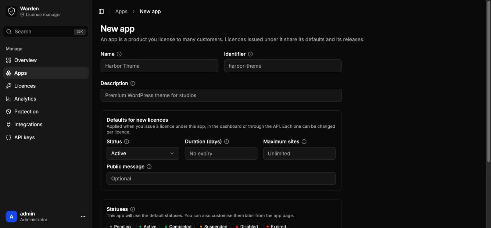 | 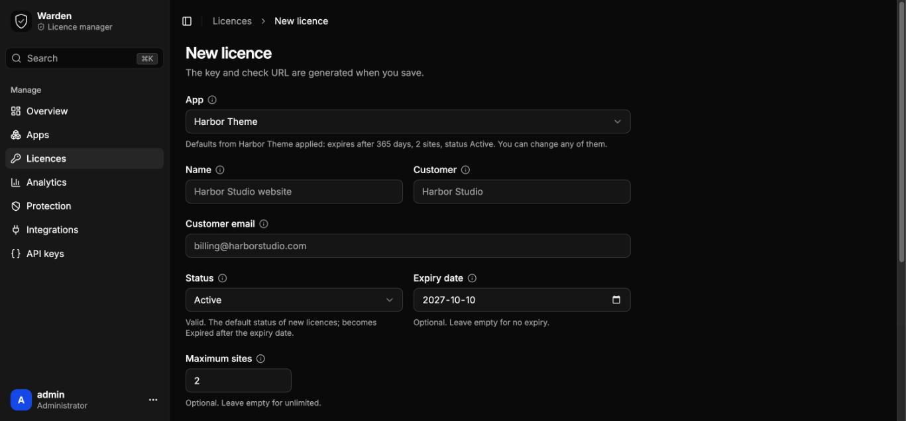 |
| Creating an app with defaults for new licences | Issuing a licence with the app's defaults |
| 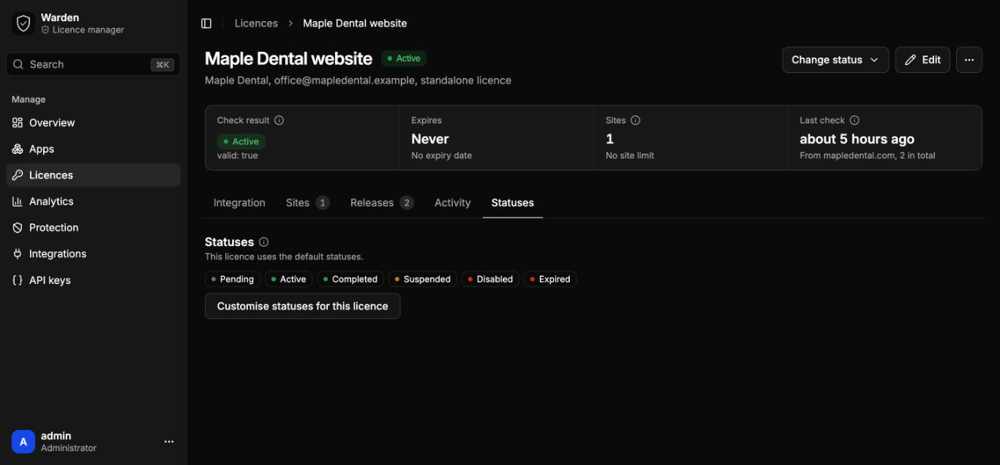 | 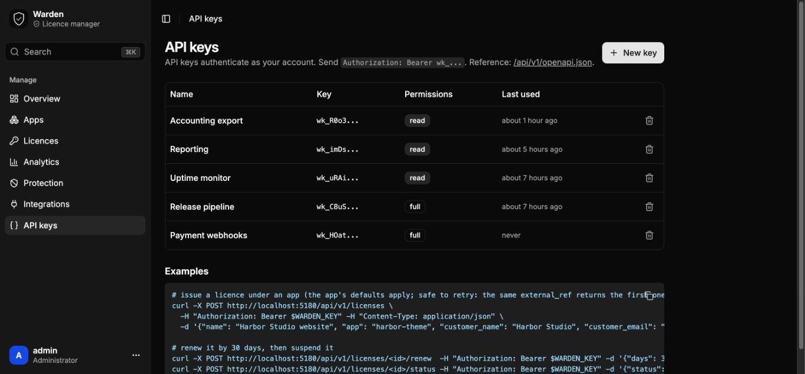 |
| A standalone licence: default statuses, customisable | API keys with their scope |

## The check URL

```
GET https://<your-worker>/check/<licence key>?domain=client-site.org
```

```json
{ "name": "Harbor Studio website", "valid": true, "status": "active", "message": "", "expires_at": "2027-03-31T23:59:59.999Z", "checked_at": "2026-10-04T16:17:30.248Z" }
```

`valid` is `true` only when the licence's status is valid (by default Active and Completed), its expiry rule has not triggered, and the domain is allowed. `status` is the licence's status key, or `domain_mismatch`, `site_limit_reached` or `unknown` (HTTP 404). Full details and verification code: [docs/checking.md](docs/checking.md).

Recommended in the site: check about every 12 hours, act only on a response you could read and verify, and **keep the last known state on network errors or 5xx**, so a Warden outage never locks a client out.

## Files and releases

Attach files to a licence or an app in the dashboard or by API. A file with a version is a **release**, offered to sites as an update ([docs/releases.md](docs/releases.md)).

```
GET https://<your-worker>/check/<licence key>?domain=client-site.org&version=1.3.0
```

```json
{ "valid": true, "status": "active", "update": { "current": "1.3.0", "available": true, "latest": { "version": "1.4.0", "changelog": "Faster gallery.", "sha256": "9f86d0...", "download_url": "https://<your-worker>/download/WRD-.../fil_...?domain=client-site.org" } } }
```

Every file, release or not, has a **release rule**: the licence statuses in which it can be downloaded, and whether the site's domain must match.

| Example | Statuses | Domain check |
|---|---|---|
| Updates for a licensed site | active, completed | on |
| Final release after full payment | completed | off |
| Maintenance or renewal notice | suspended | off |

```
GET https://<your-worker>/download/<licence key>                         # status and files, with availability
GET https://<your-worker>/download/<licence key>/<file id>?domain=site   # the file, or a JSON error (HTTP 403)
```

When the last payment of a project arrives, set the licence to **Completed**: it stays valid permanently and a file released in Completed becomes available. Every download and denied download is logged. Details and examples: [docs/files.md](docs/files.md).

## The API

Create a key on the **API** page of the dashboard and send it as `Authorization: Bearer wk_...`.

```bash
# create a licence (safe to retry: the same external_ref returns the first one)
curl -X POST https://<worker>/api/v1/licenses \
  -H "Authorization: Bearer $WARDEN_KEY" -H "Content-Type: application/json" \
  -d '{"name":"Harbor Studio website","domains":["harborstudio.com"],"duration_days":365,"external_ref":"order-1042"}'

# renew by 30 days, suspend, list what has expired
curl -X POST   https://<worker>/api/v1/licenses/<id or key>/renew  -H "Authorization: Bearer $WARDEN_KEY" -d '{"days":30}'
curl -X POST   https://<worker>/api/v1/licenses/<id or key>/status -H "Authorization: Bearer $WARDEN_KEY" -d '{"status":"suspended"}'
curl           "https://<worker>/api/v1/licenses?status=expired"   -H "Authorization: Bearer $WARDEN_KEY"
```

| Scope | Allows |
|---|---|
| `read` | list, read, stats, activity |
| `manage` | also create, edit, set status, renew |
| `full` | also delete and regenerate keys |

Endpoints: `GET /apps/{app}/versions`, `GET /me`, `GET /stats`, `GET /signing-key`, `GET|POST /webhooks`, `GET|PATCH|DELETE /webhooks/{id}` (with `/test` and `/deliveries`), `GET /statuses`, `GET|POST|DELETE /apps/{app}/statuses` and `/licenses/{id}/statuses`, `GET|POST /licenses`, `GET|PATCH|DELETE /licenses/{id}`, `POST /licenses/{id}/status`, `/renew`, `/regenerate-key`, `GET /licenses/{id}/activity`, `GET /licenses/{id}/activations`, `DELETE /licenses/{id}/activations/{domain}`, `GET|PUT /licenses/{id}/files`, `PATCH|DELETE /licenses/{id}/files/{fileId}`, `GET|POST /apps`, `GET|PATCH|DELETE /apps/{app}`, `GET|POST /apps/{app}/licenses`, `GET|PUT /apps/{app}/files`, `PATCH|DELETE /apps/{app}/files/{fileId}`, `GET|POST /apps/{app}/tracks` and `/licenses/{id}/tracks`, `GET|PATCH|DELETE .../tracks/{track}`, `GET|PUT|DELETE .../tracks/{track}/source` (with `/imports`), `GET /integrations/github` (with `/repositories`). Reference: [docs/api.md](docs/api.md), or `/api/v1/openapi.json` on your own install.

## Run and deploy

Requirements: Node 22 and a Cloudflare account.

```bash
export PATH=/opt/homebrew/opt/node@22/bin:$PATH     # if your default Node is newer than 22
npm install
printf 'ADMIN_USERNAME="admin"\nADMIN_PASSWORD="a-long-password"\n' > .dev.vars
npm run dev          # http://localhost:5173 (local D1 database, migrations applied for you)
npm test             # unit and API tests
```

Deploy to your own account from the command line instead of the button:

```bash
npm run deploy       # builds, creates the D1 database "<worker-name>-db", the R2 bucket for files and the Cron Trigger, deploys the Worker
npx wrangler secret put ADMIN_USERNAME
npx wrangler secret put ADMIN_PASSWORD
npx wrangler secret put SESSION_SECRET     # optional but recommended: openssl rand -hex 32
```

The database tables are created and upgraded by the Worker itself on the first request, so there is no migration step. Until the two admin secrets exist, the login page tells you what to add.

R2 has to be activated once in the Cloudflare dashboard (it asks for a payment method, even for the free tier). Without it, everything works except the Files section, which says so.

Use a custom domain (Workers > your Worker > Settings > Domains) so check URLs do not depend on `workers.dev`.

If your Worker is connected to a GitHub repository, Cloudflare also builds a **preview** for each pull request. A preview has no database (production's is never shared with unreleased code), so it shows a notice instead of the dashboard; the build passing is what matters. Merge the pull request to deploy.

## Under the hood

React Router 7 (SSR) on Cloudflare Workers, Cloudflare D1 (data) and R2 (files), Tailwind and shadcn/ui, TypeScript. One Cron Trigger runs every 10 minutes: it finds the time-based webhook events (grace periods, expiries, licences without a recent check), sends due webhook deliveries, and once a day deletes check history older than 90 days. The public check endpoint and the API are served by the Worker before the dashboard, and do not use cookies.

```
workers/app.ts              entry: migrations, /api/v1, /check/<key>, dashboard
app/server/check.server.ts  the check endpoint
app/server/download.server.ts  gated file downloads
app/server/signing.server.ts   the installation's Ed25519 signing key
app/server/webhooks.server.ts  outgoing webhooks: endpoints, the outbox, delivery and retries
app/server/files.server.ts  file storage in R2, checksums, releases
app/lib/releases.ts         versions, channels, the latest release
app/server/api.server.ts    API: keys, routes, validation
app/server/licenses.server.ts   licence logic shared by dashboard and API
app/lib/license.ts          statuses, key format, domain rules, the response
migrations/                 D1 schema
tests/                      node:test, runs the real SQL on a SQLite stand-in for D1
```

## Project files

- [Roadmap.md](Roadmap.md): what is done and what comes before 1.0.0
- [Security.md](Security.md): how it is protected, its limits, how to report a problem
- [CHANGELOG.md](CHANGELOG.md): what changed
- [docs/upgrade-notes.md](docs/upgrade-notes.md): what to change on your side when you upgrade
- [Licence.md](Licence.md): MIT

The dashboard UI kit (shadcn/ui components, sidebar and layout) is derived from [FormZero](https://github.com/BohdanPetryshyn/formzero) by Bohdan Petryshyn (MIT), and both copyright holders are named in the licence.
