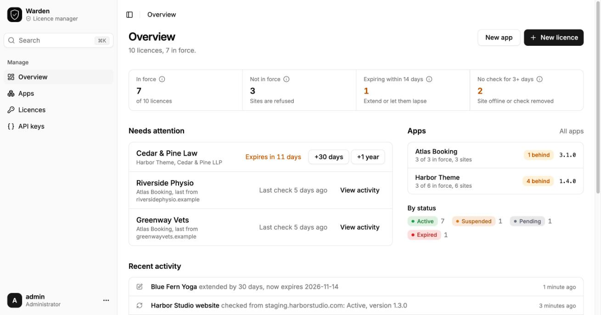

<p align="center"></p>

<h1 align="center">Warden</h1>

<p align="center">
A self-hosted licence manager that runs on Cloudflare Workers, D1 and R2.<br>
Give each customer one licence key for multiple apps,<br>
with independent statuses, shared or separate expiry dates, and app-owned releases.
</p>

<p align="center">
<a href="https://deploy.workers.cloudflare.com/?url=https://github.com/momardia54/Warden"></a>
</p>

> **Status: pre-1.0 — version 0.6.3 (2026-11-11).** This README describes the tagged app licensing model. The API and data model may still change before 1.0.0; every change is listed in [CHANGELOG.md](CHANGELOG.md). The Deploy button installs `main`; an approved build on `develop` becomes the default installation after its release pull request is merged. See [Roadmap.md](Roadmap.md) for versioning and [Security.md](Security.md) for the security model.



## Quick start

1. **Deploy** with the button above. It provisions a Worker, D1, R2 and the scheduled task. Add `ADMIN_USERNAME`, a strong `ADMIN_PASSWORD`, and preferably `SESSION_SECRET` as runtime secrets. R2 must be activated on the account. See the [documentation site](https://github.com/momardia54/Warden-docs) for setup.
2. **Create apps** for your products and custom projects: a parent theme, a customer's child theme, a plugin. Apps own statuses, release tracks, files and repository connections.
3. **Create a licence** and attach the apps, each under a stable tag. Put the single generated key in the customer's site.
4. **Check by tag** from the site. Publish releases on the apps and change each attachment's status as needed.

## One key, several apps

```text
Harbor Studio website · one WRD-… key
  parent-theme → Harbor Theme        → Active
  child-theme  → Harbor Studio Child → Completed
  booking      → Atlas Booking       → Active
```

Every attachment selects a status defined by its app. Completed can remain valid permanently while another app's Active status follows an expiry date. Choose **Shared expiry** for one date and renewal across all apps, or **Separate expiry** for independent dates and renewals. An empty date means no expiry. Grace uses a licence override, then an attachment override, then the app's live setting.

**Licence templates** prefill tags and optional apps. For example, a WordPress template supplies `parent-theme` and `child-theme`, leaving the customer's child-theme app to select. Required slots must be filled; optional slots may be skipped. Updating a template leaves existing licences intact.

Tags are unique within a licence and separate from Git version tags or release tracks. Keep them stable once the site uses them. [Apps and licences](docs/apps.md) explains the model.

## Version 0.6.0

Release limit per track, accurate outdated and up-to-date sites, the optional `WARDEN_SIGNING_KEY` secret, and a clearer overview and licence list. Migrations run by themselves; site code needs no change. See the [upgrade notes](docs/upgrade-notes.md).

## Patches 0.6.1, 0.6.2 and 0.6.3

0.6.1 stops requests waiting forever after a cancelled request. 0.6.2 makes moving between dashboard pages faster. 0.6.3 adds **Mark as urgent** to a release's menu, which puts `[urgent]` in its release notes, with an Urgent badge. No migration and no change to site code.

## Patch 0.5.1

Bug fixes for 0.5.0: tag-field validation in modern browsers, the licence page's tabs and details (public signing key on the Integration tab), one domain registration per multi-app check, links between apps and their migrated project apps, and the local review port. No migration and no API change. See [CHANGELOG.md](CHANGELOG.md).

## Upgrading to 0.5.0

Back up D1 and R2 before upgrading. Migration 0016 runs on the first request, converting standalone projects and licence-specific releases into apps while preserving existing licence keys, signing keys, file ids, stored packages and download links. Existing licences start with shared expiry and one attachment tagged `default`.

Management clients must read status and validity from each entry in `apps`. Before attaching a second app to an existing licence, update the site's checks and downloads to select its tag: a multi-app response without a tag has separate app results. Status changes require a tag; shared renewal omits it, while separate renewal requires it. The [0.4 to 0.5 upgrade notes](docs/upgrade-notes.md) cover the response changes, migrated release overrides and deprecated API fields.

## How it works

```http
GET /check/<key>?tag=parent-theme&domain=harborstudio.com&version=1.3.0&nonce=random_nonce
```

```json
{ "tag": "parent-theme", "app": { "id": "app_...", "slug": "harbor-theme", "name": "Harbor Theme" }, "valid": true, "status": "active", "message": "", "update": { "current": "1.3.0", "available": true, "latest": { "version": "1.4.0" } } }
```

The tag selects the app, its selected status determines its release track, and the channel determines which release is offered. Without a tag, a multi-app licence returns an `apps` array with separate results and no top-level validity or update. Batch checks can POST installed `versions` keyed by tag.

Responses and release checksums are signed with the installation's Ed25519 key. Clients verify the raw response signature and its key, tag, app identity, domain and nonce. Check about every 12 hours and keep the last known result on network errors, rate limits or server errors.

Warden manages licences and answers checks. **Enforcement lives in the customer's code.** See [checking.md](docs/checking.md) for PHP and JavaScript verification examples.

## Features

- Multiple apps under one licence key, with independent statuses and shared domain/site limits. Parent and child themes on one domain consume one slot.
- Shared or separate expiry dates, per-app renewals, grace periods, permanent Completed access, customer details and internal notes.
- Licence templates with stable tags, required/optional slots and optional default apps.
- App-owned release tracks, stable/beta channels, release notes, SHA-256 checksums, withdrawal and restoration. Reported versions are stored per tag and domain.
- Publishing from GitHub through a GitHub App or a token and webhook. Imports stream large archives through R2 and resume after interruptions.
- Scoped REST API keys, CSV exports with one row per attachment, traffic analytics, an IP blocklist, rate limits and blocking rules.
- Signed outgoing webhooks for licence changes, renewals, expiry, grace and missing checks, with app/tag context and retries.
- Dashboard search, light/dark themes, configurable app status definitions and colour choices.

## Files and releases

Upload files and configure tracks on **Apps → app → Releases**. A versioned file is a release; an unversioned file is an attachment. An attachment on a licence receives the release permitted by its app's selected status. Custom projects use apps too.

```http
GET /download/<key>?tag=child-theme&domain=harborstudio.com
GET /download/<key>/<file-id>?tag=child-theme&domain=harborstudio.com
```

The tag scopes both listing and direct download authorization. Checks and download lists answer with signed download links (`/download/t/<token>`), valid for 7 days, that open one file for one tag and do not contain the licence key, so updaters such as WordPress never print or log it. A link from a check already carries the domain; append `?domain=...` to a listed link when the list was requested without one. See [files.md](docs/files.md) and [releases.md](docs/releases.md).

Deleting a licence preserves apps and releases. Regenerating its key affects all attached apps. Migration 0016 preserves existing keys, file ids, package checksums, R2 objects and old download links, and converts standalone projects to apps. Read [upgrade-notes.md](docs/upgrade-notes.md) before upgrading management integrations.

## The API

```bash
curl -X POST https://<worker>/api/v1/licenses \
  -H "Authorization: Bearer $WARDEN_KEY" -H "Content-Type: application/json" \
  -d '{"name":"Harbor Studio website","expiry_mode":"shared","expires_at":"2027-11-03","external_ref":"order-1042","apps":[{"tag":"parent-theme","app":"harbor-theme"},{"tag":"child-theme","app":"harbor-studio-child","status":"completed"}]}'

curl -X POST https://<worker>/api/v1/licenses/<id>/status \
  -H "Authorization: Bearer $WARDEN_KEY" -H "Content-Type: application/json" \
  -d '{"tag":"parent-theme","status":"suspended"}'
```

`external_ref` makes creation idempotent. Read/manage/full API scopes control access. Shared renewal omits a tag; separate renewal requires one. Templates are managed at `/api/v1/license-templates`. See [api.md](docs/api.md) or your installation's `/api/v1/openapi.json`.

## Local review

```bash
export PATH=/opt/homebrew/opt/node@22/bin:$PATH
npm run review
```

This starts `http://127.0.0.1:5180`, seeds demonstration apps, sample release archives, a WordPress template and licences using both expiry modes. It prints a temporary local admin password; credentials stay in process memory and Wrangler file logging is disabled. Keep the terminal open and sign in with those credentials. Sample archives contain a README, not an installable theme or plugin. No Cloudflare deployment is performed. Remove or move an existing `.dev.vars` first, because it can override process environment credentials. Set `REVIEW_PORT` to use another port; the command stops if the port is already in use.

## Run and deploy

Requirements: Node 22 and a Cloudflare account.

```bash
export PATH=/opt/homebrew/opt/node@22/bin:$PATH     # if your default Node is newer than 22
npm install
printf 'ADMIN_USERNAME="admin"\nADMIN_PASSWORD="a-long-password"\n' > .dev.vars
npm run dev          # http://localhost:5173 (local D1 database, migrations applied for you)
npm test             # unit and API tests
```

Deploy to your own account from the command line instead of the button:

```bash
npm run deploy       # builds, creates the D1 database "<worker-name>-db", the R2 bucket for files and the Cron Trigger, deploys the Worker
npx wrangler secret put ADMIN_USERNAME
npx wrangler secret put ADMIN_PASSWORD
npx wrangler secret put SESSION_SECRET     # optional but recommended: openssl rand -hex 32
```

The signing key is stored in the database by default. It can be moved to the optional `WARDEN_SIGNING_KEY` secret: see [The signing key](docs/checking.md#the-signing-key).

The database tables are created and upgraded by the Worker itself on the first request, so there is no migration step. Until the two admin secrets exist, the login page tells you what to add.

R2 has to be activated once in the Cloudflare dashboard (it asks for a payment method, even for the free tier). Without it, everything works except the Files section, which says so.

Use a custom domain (Workers > your Worker > Settings > Domains) so check URLs do not depend on `workers.dev`.

If your Worker is connected to a GitHub repository, Cloudflare also builds a **preview** for each pull request. A preview has no database (production's is never shared with unreleased code), so it shows a notice instead of the dashboard; the build passing is what matters. Merge the pull request to deploy.

## Under the hood

React Router 7 (SSR) on Cloudflare Workers, Cloudflare D1 (data) and R2 (files), Tailwind and shadcn/ui, TypeScript. One Cron Trigger runs every 10 minutes: it finds the time-based webhook events (grace periods, expiries, licences without a recent check), sends due webhook deliveries, and once a day deletes check history older than 90 days. The public check endpoint and the API are served by the Worker before the dashboard, and do not use cookies.

```
workers/app.ts              entry: migrations, /api/v1, /check/<key>, dashboard
app/server/check.server.ts  the check endpoint
app/server/download.server.ts  gated file downloads
app/server/signing.server.ts   the installation's Ed25519 signing key
app/server/webhooks.server.ts  outgoing webhooks: endpoints, the outbox, delivery and retries
app/server/files.server.ts  file storage in R2, checksums, releases
app/lib/releases.ts         versions, channels, the latest release
app/server/api.server.ts    API: keys, routes, validation
app/server/licenses.server.ts   licence logic shared by dashboard and API
app/lib/license.ts          statuses, key format, domain rules, the response
migrations/                 D1 schema
tests/                      node:test, runs the real SQL on a SQLite stand-in for D1
```

## Project files

- [Roadmap.md](Roadmap.md): what is done and what comes before 1.0.0
- [Security.md](Security.md): how it is protected, its limits, how to report a problem
- [CHANGELOG.md](CHANGELOG.md): what changed
- [docs/upgrade-notes.md](docs/upgrade-notes.md): what to change on your side when you upgrade
- [Licence.md](Licence.md): MIT

The dashboard UI kit (shadcn/ui components, sidebar and layout) is derived from [FormZero](https://github.com/BohdanPetryshyn/formzero) by Bohdan Petryshyn (MIT), and both copyright holders are named in the licence.
